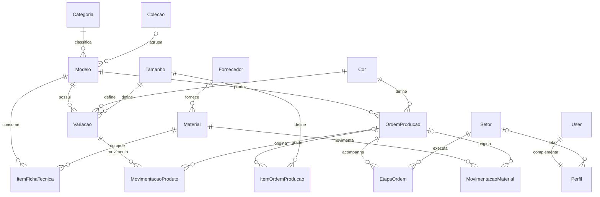

# Passo Firme — Gestão de Estoque e Produção de Calçados

Aplicação web em Django para gestão de estoque e produção de uma fábrica de calçados,
desenvolvida como trabalho prático da disciplina **GAC116 — Programação Web**.

## Integrantes

- Vinícius Souza Arantes
- Mariana Laura Gonçalves Campos Rufo

## Descrição do projeto

O Passo Firme acompanha o caminho do calçado dentro da fábrica, da compra da matéria-prima
até o par pronto no estoque:

1. Os **materiais** entram no estoque por movimentações de compra.
2. Cada **modelo** de calçado tem uma **ficha técnica**, com o consumo de material por par.
3. Uma **ordem de produção** define modelo, cor e grade de tamanhos.
4. Ao iniciar a ordem, os materiais necessários são baixados do estoque automaticamente.
5. A ordem passa pelos **setores** da fábrica, em sequência (corte, pesponto, montagem...).
6. Ao concluir a ordem, os pares entram no estoque de produto acabado, por **SKU**
   (modelo + cor + tamanho).

**Situação atual (Checkpoint 1):** modelagem do banco, ambiente administrativo com tema e
filtros, perfis de acesso e dados de demonstração. A área do usuário final (login, cadastro
e telas próprias com Bootstrap) será entregue no Checkpoint 2.

## Tecnologias utilizadas

- Python 3.12
- Django 5.2
- django-jazzmin 3.0 (tema do ambiente administrativo)
- SQLite (banco de dados relacional)

## Instalação

Pré-requisitos: Python 3.10 ou superior e Git.

```bash
git clone https://github.com/vinicius-arantes/gestao-calcados.git
cd gestao-calcados
python3 -m venv .venv
source .venv/bin/activate        # No Windows: .venv\Scripts\activate
pip install -r requirements.txt
python manage.py migrate
python manage.py popular_dados   # opcional: cria os dados de demonstração
```

No Windows, use `python` no lugar de `python3`.

## Execução

```bash
python manage.py runserver
```

Acesse o ambiente administrativo em <http://localhost:8000/admin/>.

Para rodar os testes automatizados:

```bash
python manage.py test
```

### Usuários de demonstração

Criados pelo comando `popular_dados`, com a senha `passofirme123`. O comando só funciona com
`DEBUG` ligado, para que esses usuários não sejam criados em produção.

| Usuário | Perfil | O que pode fazer |
|---|---|---|
| `admin` | Administrador | Tudo |
| `gerente` | Gerente de Produção | Tudo em catálogo e produção; consultar estoque e lançar movimentações |
| `estoquista` | Estoquista | Tudo em estoque; consultar catálogo e produção; manter SKUs |
| `operador` | Operador | Consultar catálogo e produção; atualizar etapas. Não acessa o admin: usará a área do usuário final (Checkpoint 2) |

Para criar apenas os grupos e as permissões, sem os dados de demonstração, use
`python manage.py criar_grupos`.

## Principais funcionalidades

**Catálogo**
- Categorias, coleções, cores e tamanhos
- Modelos com ficha técnica, custo de matéria-prima e margem calculados
- Variações (SKU) com saldo em pares e estoque mínimo

**Estoque**
- Fornecedores e materiais, com saldo e estoque mínimo
- Movimentações de material e de produto acabado, que atualizam o saldo ao criar, editar e
  excluir, e bloqueiam saída maior que o saldo

**Produção**
- Ordens de produção com número automático, prioridade, prazo e grade de tamanhos
- Etapas criadas automaticamente para cada setor ativo, avançando na sequência dos setores
- Iniciar a ordem valida a ficha técnica e o saldo e dá baixa nos materiais
- Concluir a ordem exige todas as etapas concluídas e dá entrada dos pares no estoque

**Ambiente administrativo**
- Tema Jazzmin, com seletor de modo claro/escuro na barra superior
- Filtros personalizados:
  - Modelos: faixa de preço e presença de ficha técnica
  - SKUs e materiais: situação do estoque
  - Movimentações: origem (ordem de produção ou lançamento manual)
  - Ordens: prazo e setor atual
  - Usuários: perfil de acesso
- Ações em massa para iniciar, concluir e cancelar ordens e para ativar e desativar modelos

## Modelagem do banco de dados



## Estrutura do projeto

```text
gestao-calcados/
├── config/              # Configurações do projeto (settings, urls, tema Jazzmin)
├── catalogo/            # Categorias, coleções, cores, tamanhos, modelos, ficha técnica e SKUs
├── estoque/             # Fornecedores, materiais e movimentações
├── producao/            # Setores, ordens de produção, grade e etapas
│   ├── services.py      # Regras do fluxo: iniciar, avançar etapa e concluir ordem
│   └── management/commands/popular_dados.py
├── contas/              # Perfil de usuário e grupos de acesso
│   └── management/commands/criar_grupos.py
├── templates/           # Templates globais
├── static/              # Arquivos estáticos globais
├── manage.py
└── requirements.txt
```

## Fluxo de trabalho no Git

- `main`: versões entregues
- `develop`: integração das funcionalidades
- `feature/*` e `hotfix/*`: uma branch por tarefa, integrada à `develop` por pull request
  revisado pela outra pessoa do grupo
